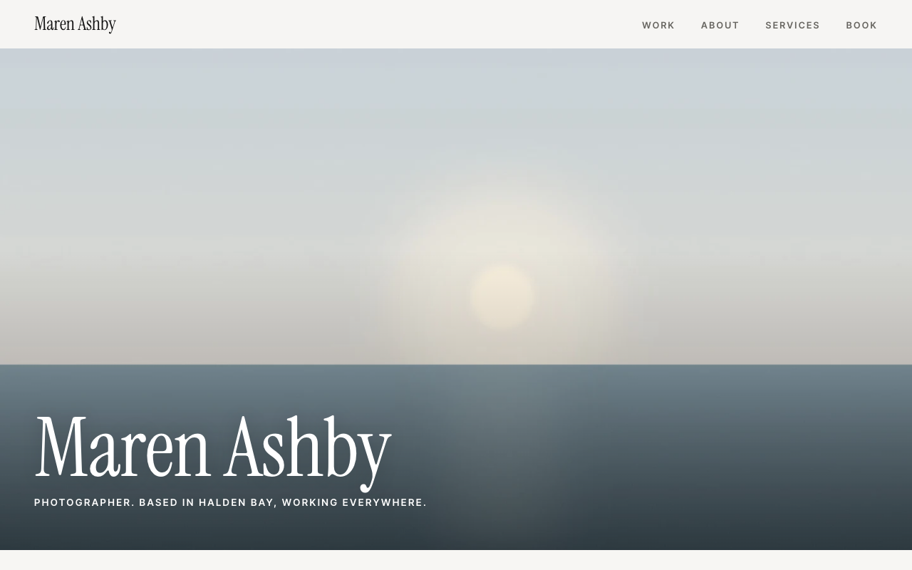

# Maren Ashby: photography portfolio template

A minimal, editorial photography portfolio and photography website template with full-bleed galleries, a keyboard-friendly lightbox, services and pricing, and a booking inquiry form. Built with Astro as a fully static site.



[](https://console.cloudzyro.com/new?repo=https://github.com/Cloudzyro/template-photography)

## What's included

- Full-bleed home page hero, introduction, selected work and commissions
- Collections from one data file: an overview page plus a page per collection with an edge-to-edge gallery in justified rows that keeps each photo's shape
- Lightbox built on the native dialog element: opens from keyboard or mouse, Left and Right arrow keys (plus Home and End) move between photos, Escape closes, focus stays inside while it's open and returns to the photo you opened, visible counter and captions, swipe on touch screens, neighbors preloaded
- Astro image optimization: every photo is resized into several WebP widths with `srcset`, and the lightbox loads a large optimized version
- About page with selected clients
- Services and pricing page with a short FAQ; each Inquire button preselects the session type on the booking form
- Booking inquiry form that works without a server
- Light and dark themes that follow the visitor's system setting
- Open Graph tags (each collection shares its own cover), structured data, sitemap, robots.txt and favicon
- Responsive down to 360px, visible focus styles and reduced motion respected
- No tracking and no third-party scripts

The photos that ship with the template are generated abstract placeholders (gradients, horizons and soft light), not real photographs.

## Run it locally

You need Node 22.23 or newer and pnpm.

```bash
pnpm install
pnpm dev       # http://localhost:4321
pnpm build     # static site in dist/
pnpm preview   # serve the build
```

## Make it yours

- **Content:** everything lives in `src/data/site.ts`: your name, contact details, the home page photo, collections and their photos (file name, alt text, caption), the about text, services and prices.
- **Photos:** put your images in `src/assets/photos/` (JPG, PNG, WebP or AVIF) and refer to them by file name in `src/data/site.ts`. Export them at around 2000 to 3000 pixels on the long edge; the build makes the smaller sizes. Delete the placeholders you don't use. Always write alt text that describes the photo.
- **Booking form:** set `PUBLIC_FORM_ENDPOINT` to a form service address (Formspree, Basin, a Supabase function or similar). The form posts its fields there. With no endpoint set, the form shows a short note and opens the visitor's email app addressed to your `email`.
- **Site address:** set `SITE_URL` (for example `https://www.yourstudio.com`) so the sitemap, canonical links and social previews use it.
- **Colors and fonts:** the variables at the top of `src/styles/global.css`, with a light set and a dark set. Fonts are Instrument Serif and Inter Tight, self-hosted through Fontsource; swap the packages and the `--font-*` variables to change them.
- **Social preview image:** replace `public/og.png` (1200 x 630). Collection pages use their cover automatically.
- **Placeholders:** `pnpm placeholders` regenerates the abstract images (`scripts/generate-placeholders.mjs`). You won't need it once you use your own photos.

Copy `.env.example` to `.env` to set the variables locally. On Cloudzyro, add them in your site's environment settings.

## Deploy

Click the button above to make your own copy and put it online, or push your copy to GitHub and connect the repository in the Cloudzyro console. It builds with `pnpm build` and serves the static `dist/` folder.

## Stack

- [Astro](https://astro.build) 7, static output, with `astro:assets` image optimization (sharp)
- `@astrojs/sitemap`
- Instrument Serif and Inter Tight via Fontsource
- Plain CSS, a little TypeScript for the menu, lightbox and form

## License

MIT, see [LICENSE](./LICENSE).
